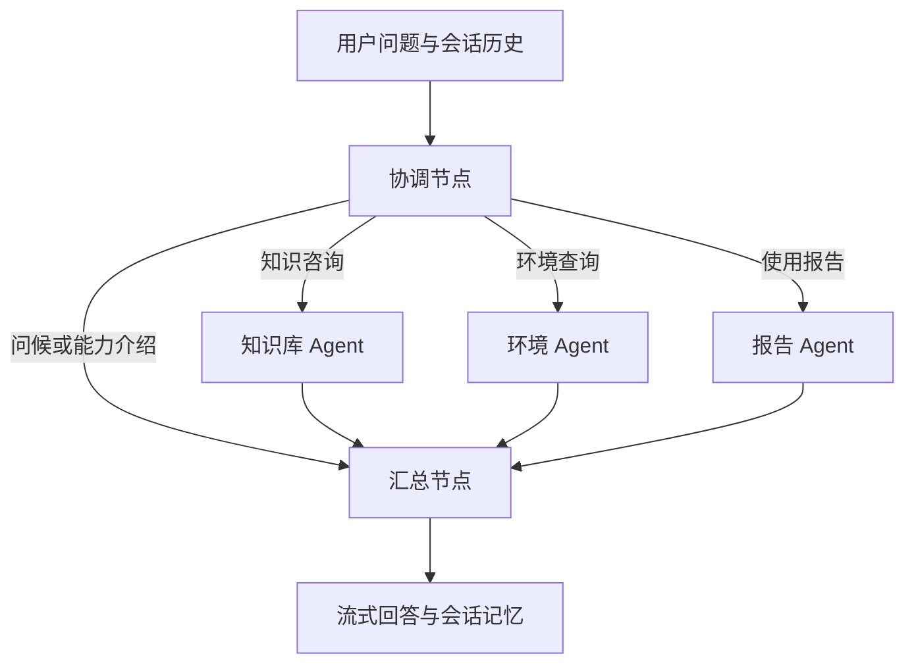

# 扫地机器人智能客服：LangGraph 多 Agent 协作

基于 Streamlit、LangChain、LangGraph 和 Chroma 的中文客服学习项目。协调节点识别用户需求，选择知识库、环境和报告 Agent，最后由汇总节点组织回答。支持选购咨询、基础排障、维护保养、实时天气查询和演示月度使用报告。

当前页面入口为 `app.py`，后端入口为 `agent/multi_agent.py`。旧版单 Agent 实现 `agent/react_agent.py` 仍保留，但页面已切换到多 Agent 总图。

## 功能与架构

| 节点 | 职责 | 可用业务工具 |
| --- | --- | --- |
| 协调节点 `supervisor` | 结合历史补全任务，结构化输出本轮 Agent 列表 | 无 |
| 知识库 Agent `knowledge` | 决定检索问题，调用 RAG；将工具结果交给汇总节点 | `rag_summarize` |
| 环境 Agent `environment` | 获取城市、实时天气、温度和湿度，说明查询失败 | `get_user_location`、`get_weather` |
| 报告 Agent `report` | 根据当前演示用户的记录生成报告，保留月份回退说明 | `fetch_usage_report` |
| 汇总节点 `summary` | 整合专业结果，保留事实与限制，生成最终回答 | 无 |



协调节点可以选择多个专业 Agent。当前总图会并行执行选中的专业节点，完成后汇总一次。例如“查询上海天气，并说明潮湿天气如何保养机器人”会分配给环境和知识库 Agent。

- **流式输出**：只向页面输出 `summary` 节点的文本，不展示内部 Agent 和工具消息；保留模型消息 ID，避免完整回答重复输出。
- **短期记忆**：默认保留最近 5 轮，并受约 4000 token 的粗估上限约束；按 `session_id` 区分，只保存用户问题和最终回答。流式调用正常结束且被完整消费后才保存本轮。
- **报告身份**：页面选择的演示用户通过 `AgentContext` 传入，报告工具从运行上下文读取身份，模型不能通过工具参数指定用户 ID。
- **工具监控**：记录耗时、调用次数和异常；对指定工具的部分异常有限重试。耗时告警不等于主动取消请求。

### RAG 检索流程

```text
完整检索问题
  → 查询改写（保留原问题并生成变体）
  → 各查询执行向量召回 + BM25 中文关键词召回
  → 同义词扩展、动态权重与 RRF 排名融合
  → Cross-Encoder 重排、多查询融合
  → RAG 模型基于资料生成总结
  → 知识节点提取工具返回，交给最终汇总节点
```

向量库使用 Chroma，关键词检索使用 jieba 和 BM25，重排器默认使用 `BAAI/bge-reranker-base`。首次加载工具模块时会检查本地索引；索引为空时尝试构建，已有索引通过 MD5 记录跳过已处理内容。

## 快速开始

### 1. 安装依赖

当前本地开发环境为 Python 3.14.5；其他 Python 版本及系统组合未在本轮全面验证。依赖范围见 [requirements.txt](requirements.txt)。

Windows PowerShell：

```powershell
git clone https://github.com/xpy12367/robot-cleaner-agent.git
cd robot-cleaner-agent

py -m venv .venv
.\.venv\Scripts\Activate.ps1
python -m pip install --upgrade pip
python -m pip install -r requirements.txt
```

已下载项目时，直接在项目根目录创建或启用虚拟环境即可。

### 2. 配置连接

推荐复制配置模板：

```powershell
Copy-Item .env.example .env
```

编辑项目根目录的 `.env`，填写实际值：

```dotenv
DASHSCOPE_API_KEY=你的百炼API_Key
DASHSCOPE_BASE_URL=https://你的服务地址/compatible-mode/v1
AMAP_KEY=你的高德Web服务Key
```

- `DASHSCOPE_API_KEY`、`DASHSCOPE_BASE_URL` 为模型调用必需配置；地址以所用百炼服务的控制台为准。
- `AMAP_KEY` 用于定位与天气查询，不配置时这些功能会返回失败提示。
- 模型与 Embedding 名称在 `config/agent.yaml` 中配置。协调节点依赖工具调用形式的结构化输出，所选兼容服务需要支持该能力。
- 系统环境变量优先于 `.env`，加载使用 `override=False`。

也可以设置 PowerShell 环境变量，或在 `.streamlit/secrets.toml` 中配置同名字段。页面侧边栏支持临时填写 API Key 和 Base URL，但会修改服务进程的环境变量，适用于本地演示。命令行检查脚本使用环境变量或 `.env`，不会通过页面读取 `secrets.toml`。

### 3. 启动页面

```powershell
python -m streamlit run app.py
```

页面可在未配置密钥时启动；首次提问前需要配齐模型连接。首次进入专业工具可能初始化索引、分词器和重排模型，首次下载模型或构建 Embedding 索引需要网络和额外时间。索引构建会调用配置的 Embedding 服务。

也可提前检查或构建索引：

```powershell
python -m rag.vector_store
```

修改提示词或模型配置后，建议重启服务，让模块与缓存重新加载。

## 使用示例

| 输入 | 预期处理 |
| --- | --- |
| 扫地机器人的滚刷缠了头发，应该如何清理？ | 知识库 Agent 检索资料，汇总回答 |
| 查询上海当前天气和湿度，并说明潮湿天气下的保养注意事项 | 环境与知识库 Agent 协作 |
| 生成2026年7月的扫地机器人使用报告 | 报告 Agent 查询记录，标注实际数据月份 |
| 你好，你能帮我做什么？ | 直接由汇总节点介绍能力 |

报告使用 `data/external/records.csv` 中的演示数据，目前包含 10 个用户、`2026-06` 的记录。请求其他月份时，工具返回最近可用月份，并以 `requested_month`、`data_month`、`used_latest_available` 区分请求和实际数据。未选择演示用户时，不查询记录。

页面“清空对话”会同时清空当前页面消息和对应后端记忆。演示用户选择与聊天会话是两个独立概念：切换演示用户不会自动清空已有对话，需要独立演示时请先清空对话。

### Python 调用

在项目根目录启动 Python 后：

```python
from agent.multi_agent import MultiAgent

service = MultiAgent(enable_memory=True, max_history_turns=5)

answer = service.execute(
    "生成2026年7月的扫地机器人使用报告。",
    session_id="demo-session",
    user_id="1001",  # 由调用方提供的演示身份，不是模型生成的参数。
)
print(answer)

for text in service.execute_chat_stream(
    "刚才的报告实际使用的是哪个月份？",
    session_id="demo-session",  # 相同 ID 才会加载同一份聊天历史。
    user_id="1001",
):
    print(text, end="", flush=True)

service.clear_memory(session_id="demo-session")
```

上述调用会使用实际模型服务，可能产生费用。

## 项目结构

```text
.
├─ app.py                         # Streamlit 页面，多 Agent 服务入口
├─ agent/
│  ├─ multi_agent.py              # 普通/流式调用、历史加载与保存
│  ├─ graph.py                    # StateGraph 节点、条件路由与汇合
│  ├─ state.py                    # 任务状态 MultiAgentState 与 AgentContext
│  ├─ supervisor.py               # 任务分配与指代补全
│  ├─ knowledge_agent.py          # 知识库专家与工具结果交接
│  ├─ environment_agent.py        # 城市、实时天气查询
│  ├─ report_agent.py             # 演示报告与用户上下文传递
│  ├─ summary.py                  # 最终回答汇总
│  ├─ memory_manager.py           # 按会话管理短期记忆
│  ├─ react_agent.py              # 保留的旧版单 Agent 实现
│  ├─ check_*.py                  # 分阶段的手动检查脚本
│  └─ tools/                     # RAG、天气、报告工具及监控中间件
├─ rag/                          # 索引、查询改写、混合检索和重排
├─ model/factory.py              # ChatOpenAI / OpenAIEmbeddings 客户端
├─ config/                       # 模型、向量库、RAG 配置与同义词表
├─ prompts/                      # 协调、专业 Agent、汇总和 RAG 提示词
├─ data/                         # TXT/PDF 知识资料及演示 CSV
├─ tests/                        # 单元测试与部分手动集成检查
├─ docs/                         # 记忆、监控等补充说明
├─ utils/                        # 配置、路径、日志与文档加载工具
├─ .streamlit/                   # Streamlit 配置
├─ .env.example                  # 无真实凭据的环境变量模板
└─ requirements.txt
```

### 配置位置

| 文件 | 用途 |
| --- | --- |
| `config/agent.yaml` | 模型名称、环境变量名、演示记录路径 |
| `config/chroma.yaml` | Chroma 路径、分块、召回数量、融合默认权重 |
| `config/rag.yaml` | 查询改写及检索增强相关配置 |
| `config/synonyms.txt` | 中文领域同义词映射 |
| `prompts/*_prompt.txt` | 各节点的职责与输出约束 |

注意：当前部分检索增强参数仍使用构造器默认值。`VectorStoreService.get_hybrid_retriever()` 尚未把 `rag.yaml` 中所有重排、动态权重和同义词开关传入检索器；不能假定修改这些 YAML 字段就一定改变运行行为。

## 测试与检查

### 不调用真实模型或天气的测试

在本轮本地验证中，以下三组共 26 项通过：

```powershell
python -m unittest discover -s tests -p test_memory.py -v
python -m unittest discover -s tests -p test_monitor.py -v
python -m unittest discover -s tests -p test_smoke.py -v
```

分别覆盖记忆管理、监控与重试、页面渲染和连接字段校验。这些测试不证明真实模型回答正确，也不代表进行了浏览器视觉检查。

不要把全量 `unittest discover` 当作纯离线检查：`tests/` 中部分模块会在导入时加载模型客户端或 RAG 服务，部分检查以普通函数编写，不会被 unittest 自动执行。

### 真实调用的手动检查

以下命令应在项目根目录执行，需要模型连接，可能产生费用；环境检查还涉及天气请求，部分用例用模拟定位失败验证分支。

```powershell
python -m agent.check_supervisor
python -m agent.check_knowledge
python -m agent.check_environment
python -m agent.check_report
python -m agent.check_summary
python -m agent.check_graph
```

这些脚本用于观察路由、工具结果、专业结果和最终回答，不能只凭脚本正常退出就判定回答质量通过。

本轮手动验证覆盖了专业节点调用、双 Agent 协作、报告月份回退、未选择用户、页面短期记忆与清空，以及流式重复输出修正。尚未完成系统性的回答质量、召回率、延迟和并发评测，也未在本轮验证全新空索引的真实重建。

## 已知限制

- 模型仍可能补充资料之外的内容。知识节点直接交接 RAG 工具结果，减少了一次改写扩充，但 RAG 总结和最终汇总仍需检查依据。
- 天气接口可能超时。当前天气工具会将部分网络异常转成失败文本，因此监控中的“执行成功”只表示函数正常返回，不保证天气查询成功，也不会触发基于异常的重试。
- 定位基于服务端出口 IP，并非浏览器精确位置；远程部署时可能与用户实际城市不同。明确指定城市更可靠。
- 多 Agent 和查询改写增加模型调用，延迟及费用会波动。5 秒、10 秒监控阈值仅用于告警；`recursion_limit` 限制图的执行步数，不是请求超时秒数。
- 记忆目前保存在进程内，未使用 LangGraph checkpointer；不是跨重启的持久记忆，也未验证同一会话并发提问。
- 工具共用 `agent_tools.py`，其导入会初始化 RAG，所以首次进入天气或报告功能也可能出现知识库加载日志。
- 本地旧索引可能保留旧目录的来源元数据；MD5 去重不等于完整的文档更新、删除同步。
- 演示用户选择不是登录认证；页面连接配置使用进程环境变量，当前实现面向本地学习演示，不具备生产多租户隔离能力。

## 本地文件与资料来源

`.venv/`、`logs/`、`chroma_db/`、`md5.text`、IDE 配置与 Python 缓存已在 `.gitignore` 中忽略。不要提交真实 API Key、个人连接地址、`.env` 或 `.streamlit/secrets.toml`；分享日志前检查其中的对话与工具数据。

知识库来源和适用边界见：

- [来源清单](data/external/来源清单.md)
- [知识库元数据](data/external/知识库元数据.md)

本项目用于通用问答和基础排障，具体操作以对应型号说明书和官方售后意见为准。

## 许可证

除 `data/` 目录外，源代码和项目原创文档采用 [MIT License](LICENSE)。

`data/` 不属于 MIT 授权范围，其中包含演示数据、知识库摘要及基于第三方官方资料归纳的文档，详见 [data/LICENSE.md](data/LICENSE.md)。
